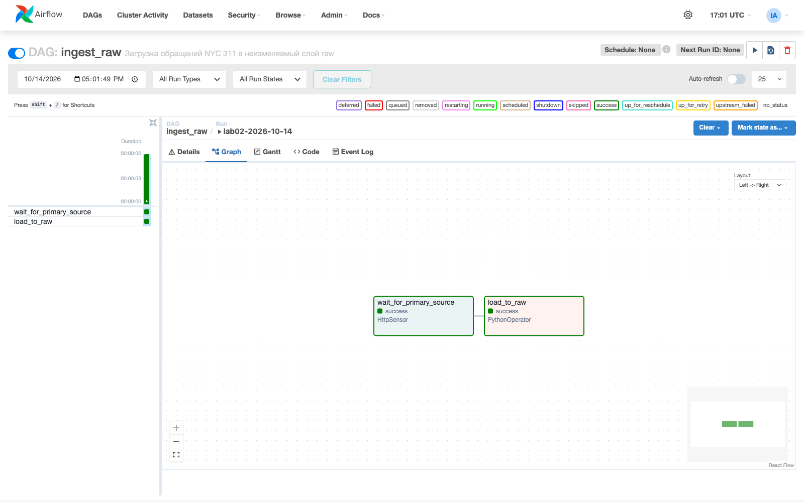
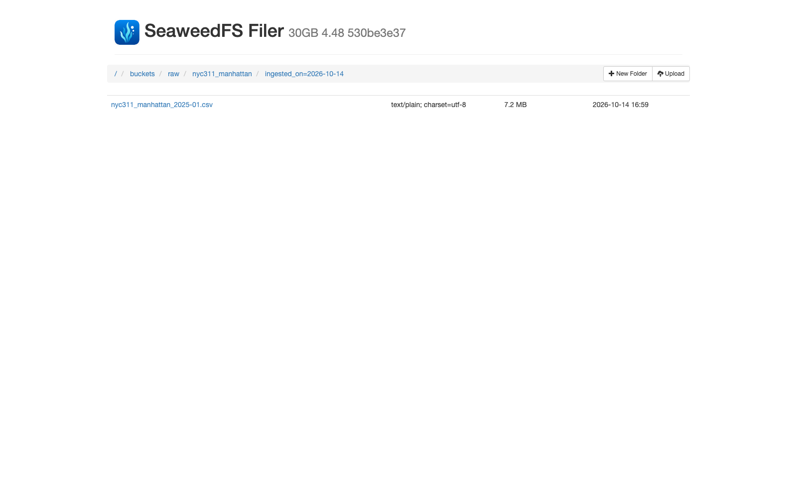

# Проверки ЛР № 2

Проверено 2026-10-14 на работающих Airflow и SeaweedFS

- Бакеты `raw`, `staging`, `mart` созданы инфраструктурой до запуска DAG
- Запуск `lab02-2026-10-14` завершился успешно с логической датой `2026-10-14`
- После очистки задач тот же запуск снова завершился успешно
- До и после повтора совпадают SHA256, ETag, LastModified, размер и ключ объекта
- В партиции остался один CSV размером 7 186 012 байт
- SHA256 raw-объекта совпадает с резервным снимком из `data/source/`
- DuckDB прочитал напрямую из S3 все 61 331 строку
- Ruff и 5 модульных тестов прошли, HTTP и S3 в модульных тестах заменены mock-объектами

[Состояние Airflow](airflow_run.json), [бакеты до загрузки](buckets_before_ingestion.json),
[объект до повтора](raw_before_rerun.json), [объект после повтора](raw_after_rerun.json),
[вывод DuckDB](duckdb_read.txt)

