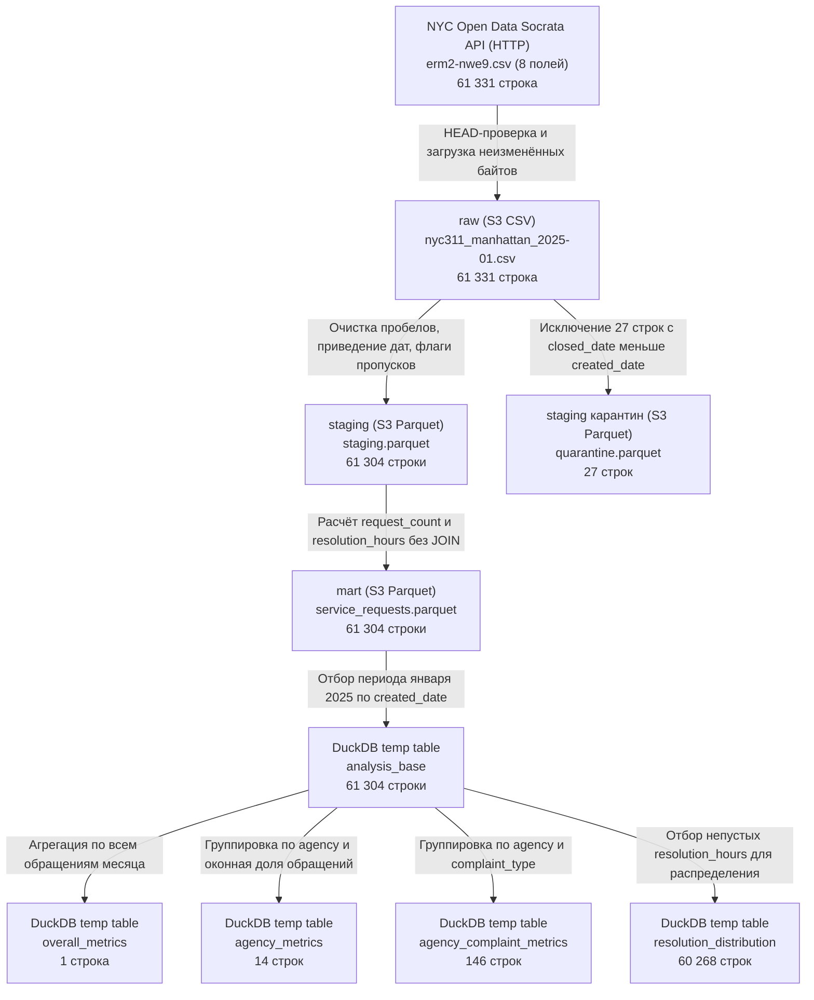

# Происхождение данных обращений NYC 311

## Контекст анализа

### Вопрос

Как различались число обращений и медианное время до закрытия по типам проблем и ответственным агентствам в Манхэттене в январе 2025 года?

### Выбранное значение метрики

Для разбора выбрано медианное время до закрытия обращений агентства `HPD` в Манхэттене за январь 2025 года, оно составляет **84,25 часа** (единица измерения часы, период `[2025-01-01, 2025-02-01)` по `created_date`, снимок от `2026-10-14`).
В срез `agency = 'HPD'` вошли **24 333** обращения (`requests_count`).
Из них в расчёт медианы попали **24 268** записей с заполненным временем до закрытия (`closed_count`), а **65** обращений без даты закрытия (`unclosed_count`) остались в общем подсчёте заявок, но не участвовали в медиане.

### Исходные данные

Первоисточник представляет собой публичный набор *311 Service Requests from 2020 to Present* (`erm2-nwe9`), публикуемый NYC Office of Technology and Innovation через Socrata API (`https://data.cityofnewyork.us/resource/erm2-nwe9.csv`, точный запрос сохранён в [data/source/source_url.txt](../data/source/source_url.txt) и [data/source/manifest.json](../data/source/manifest.json)).
Выгрузка содержит 8 выбранных полей по обращениям Манхэттена за январь 2025 года, снимок собран `2026-10-14` (SHA-256 `645bfe253cf4705f35d9381cc26d456b722c18e0bbc96562b4d7e54f247294d8`).

Загрузка выполняется DAG `ingest_raw` в Airflow ([airflow/dags/ingest_raw.py](../airflow/dags/ingest_raw.py) и [src/ingestion/load_raw.py](../src/ingestion/load_raw.py)).
`HttpSensor` проверяет доступность URL методом `HEAD`, затем `PythonOperator` скачивает CSV без изменения байтов и сохраняет его в SeaweedFS по S3 API без перезаписи существующего ключа.

| Исходные данные | Путь в `raw` |
|---|---|
| Обращения NYC 311 (Манхэттен, январь 2025) | `s3://raw/nyc311_manhattan/ingested_on=2026-10-14/nyc311_manhattan_2025-01.csv` |

## Схема происхождения данных (data lineage)

| Переход | Где выполняется и что подтверждено проверками |
|---|---|
| HTTP-источник -> `raw` | [airflow/dags/ingest_raw.py](../airflow/dags/ingest_raw.py) и [src/ingestion/load_raw.py](../src/ingestion/load_raw.py). Протокол запусков и совпадение SHA-256 до и после повтора сохранены в [docs/evidence/](evidence/README.md). |
| `raw` -> `staging` и `quarantine` | [notebooks/profile_quality.ipynb](../notebooks/profile_quality.ipynb), отчёт в [docs/data_quality_report.md](data_quality_report.md). Проверены 5 правил качества (уникальность ключа, период создания, заполненность темы и агентства, порядок дат). Баланс `61 331 = 61 304 + 27`, в `staging` нет критических нарушений, оба флага пропусков везде `false`. |
| `staging` -> `mart` | [notebooks/build_mart.ipynb](../notebooks/build_mart.ipynb), описание модели в [docs/mart.md](mart.md). Сборка идёт без `JOIN` и без фильтрации строк. Повторное чтение из S3 подтвердило сохранение всех 61 304 строк, уникальность `unique_key`, 1 036 пропусков `resolution_hours`, совпадение значений и флагов со `staging`. |
| `mart` -> `analysis_base` -> таблицы ЛР № 5 | [notebooks/calculate_metrics.ipynb](../notebooks/calculate_metrics.ipynb), описание в [docs/metrics.md](metrics.md). Ячейка 3 (`lab05-04`) загружает `analysis_base`, ячейка 4 (`lab05-06`) считает `overall_metrics`, ячейка 5 (`lab05-08`) формирует `agency_metrics`, ячейка 6 (`lab05-10`) строит `agency_complaint_metrics` и `resolution_distribution`. Ячейка 7 (`lab05-12`) проходит все 7 проверок согласованности. |

| Слой | Путь объекта в SeaweedFS |
|---|---|
| `raw` | `s3://raw/nyc311_manhattan/ingested_on=2026-10-14/nyc311_manhattan_2025-01.csv` |
| `staging` | `s3://staging/nyc311_manhattan/source_ingested_on=2026-10-14/staging.parquet` |
| `quarantine` | `s3://staging/nyc311_manhattan/source_ingested_on=2026-10-14/quarantine.parquet` |
| `mart` | `s3://mart/nyc311_manhattan/source_ingested_on=2026-10-14/service_requests.parquet` |

## Маршрут данных для выбранного значения метрики

Значение **84,25 часа** прослеживается от сохранённого вывода в ноутбуке до исходного CSV в `raw`.

1. **Вывод и расчёт в ЛР № 5.** В [notebooks/calculate_metrics.ipynb](../notebooks/calculate_metrics.ipynb) в выводе ячейки 5 (`lab05-08`, раздел «Основная группировка по агентствам») нужно взять строку `agency = 'HPD'` и столбец `median_resolution_hours`, где выведено `84.25`.
   Запрос создаёт временную таблицу `agency_metrics`, группирует строки `analysis_base` по полю `agency` и считает `median(resolution_hours)` вместе с числом обращений `sum(request_count)` и числом заполненных длительностей `count(resolution_hours)`.
   Для `HPD` каждая строка соответствует одному уникальному обращению (`unique_key`, `request_count = 1`), всего 24 333 строки.
   65 обращений с `closed_date IS NULL` имеют `resolution_hours IS NULL`, поэтому они входят в `requests_count` и `unclosed_count`, но автоматически пропускаются функцией `median(resolution_hours)`.
   19 закрытых обращений `HPD` с `resolution_hours = 0` (`created_date = closed_date`) являются известными нулями и участвуют в расчёте медианы среди 24 268 значений (`closed_count`).
   Отрицательные длительности отсутствуют, так как отфильтрованы на этапе качества.

2. **Входная выборка и сборка витрины.** Таблица `analysis_base` создаётся в ячейке 3 (`lab05-04`, раздел «Подключение и входная выборка») того же ноутбука из витрины `s3://mart/nyc311_manhattan/source_ingested_on=2026-10-14/service_requests.parquet` с фильтром периода `created_date >= TIMESTAMP '2025-01-01' AND created_date < TIMESTAMP '2025-02-01'`.
   В период попадают все 61 304 строки витрины.
   Сама витрина собирается в [notebooks/build_mart.ipynb](../notebooks/build_mart.ipynb) (ячейки 4 и 5, `lab04-06` и `lab04-08`) из `staging.parquet` без соединений и дополнительной фильтрации.
   Поля `created_date`, `closed_date` и `agency` переносятся напрямую, `request_count` задаётся константой `1::INTEGER`, а `resolution_hours` вычисляется из двух полей `created_date` и `closed_date` как `date_diff('microsecond', created_date, closed_date) / 3600000000.0`.
   Таким образом, исходное поле `created_date` участвует сразу в двух местах, как фильтр периода и как начало интервала для `resolution_hours`.

3. **Подготовка `staging` из `raw`.** В [notebooks/profile_quality.ipynb](../notebooks/profile_quality.ipynb) исходный CSV `s3://raw/nyc311_manhattan/ingested_on=2026-10-14/nyc311_manhattan_2025-01.csv` читается из S3 как текст.
   У `agency` удаляются краевые пробелы, пустые строки переводятся в `NULL` с выставлением флага `quality_missing_agency`, а текстовые `created_date` и `closed_date` приводятся к `TIMESTAMP`.
   Из 61 331 строки `raw` в `quarantine.parquet` ушли 27 записей по правилу `valid_closure_order` (`closed_date < created_date`).
   Все 27 карантинных строк относились к агентству `DOT`, поэтому для `HPD` все 24 333 исходные записи из `raw` дошли до `staging`, `mart` и `analysis_base`.

### Словарь ключевых полей

| Поле витрины | Смысл, тип и единица измерения | Источник, преобразование и роль в расчёте |
|---|---|---|
| `resolution_hours` | Наблюдаемое время до закрытия обращения, `DOUBLE`, часы | Вычисляется в `build_mart.ipynb` из `created_date` и `closed_date` слоя `staging` (`date_diff` в микросекундах, делённый на `3 600 000 000.0`), при отсутствии `closed_date` остаётся `NULL`. Передаётся в `median(resolution_hours)` и `count(resolution_hours)`. |
| `created_date` | Дата и время регистрации обращения, `TIMESTAMP`, без часового пояса | Одноимённое поле из `raw` приводится к `TIMESTAMP` в `profile_quality.ipynb` и переносится в витрину. Задаёт отбор января 2025 в `analysis_base` и служит началом интервала при расчёте `resolution_hours`. |
| `closed_date` | Дата и время закрытия обращения, `TIMESTAMP`, без часового пояса | Одноимённое поле из `raw` приводится к `TIMESTAMP` в `profile_quality.ipynb` (27 строк с `closed_date < created_date` уходят в карантин) и переносится в витрину. Задаёт конец интервала для `resolution_hours` и условие `closed_date IS NULL` для `unclosed_count`. |
| `agency` | Аббревиатура ответственного городского агентства, `VARCHAR` | Одноимённое поле из `raw` очищается от краевых пробелов в `profile_quality.ipynb` с контролем флага `quality_missing_agency` и переносится в витрину. Используется в `GROUP BY agency` и задаёт срез `agency = 'HPD'`. |
| `request_count` | Счётчик обращений, `INTEGER`, обращения | Константа `1::INTEGER` на каждую уникальную строку `staging` (`unique_key`) в `build_mart.ipynb`. Сумма по группе даёт размер среза `requests_count` и знаменатель для долей. |

Полный маппинг всех девяти полей витрины находится в [docs/mart.md](mart.md), определения остальных метрик в [docs/metrics.md](metrics.md).

## Влияние исключения нулевой длительности из расчёта времени до закрытия

Рассмотрим изменение правила расчёта времени до закрытия в ЛР № 5, если исключить обращения с `resolution_hours = 0` (`created_date = closed_date`) и учитывать только строго положительные длительности `resolution_hours > 0`.

Такое изменение возникает на шаге расчёта метрик в [notebooks/calculate_metrics.ipynb](../notebooks/calculate_metrics.ipynb) в ячейках 4, 5, 6 и 7 (`lab05-06`, `lab05-08`, `lab05-10`, `lab05-12`) через добавление условия `FILTER (WHERE resolution_hours > 0)` к `median(resolution_hours)` и `count(resolution_hours)`, а также фильтра `AND resolution_hours > 0` при построении `resolution_distribution`.
Слои `raw`, `staging`, `quarantine`, витрина `mart` (`service_requests.parquet`) и временная таблица `analysis_base` при этом не меняются.

Через поле `resolution_hours` и новый фильтр изменение затронет 933 записи с `resolution_hours = 0`, распределённые между пятью агентствами (`DOHMH` 394, `DOB` 261, `DEP` 225, `DOT` 34 и `HPD` 19).

- В `overall_metrics` значение `closed_count` уменьшится с 60 268 до 59 335, а `median_resolution_hours` вырастет с 31,87 до 34,31 часа. Метрики `requests_count`, `unclosed_count` и `unclosed_share_pct` не изменятся.
- В `agency_metrics` значения `closed_count` и `median_resolution_hours` изменятся только у пяти агентств с нулевыми длительностями (заметнее всего у `DOHMH` с 43,90 до 121,01 часа и у `DOB` с 63,62 до 133,64 часа). У остальных девяти агентств (`NYPD`, `DSNY`, `TLC`, `DHS`, `EDC`, `DPR`, `DCWP`, `DOE`, `OTI`) все показатели сохранятся, а `requests_count`, `unclosed_count`, `unclosed_share_pct` и `share_of_requests_pct` не изменятся ни у одного агентства.
- В `agency_complaint_metrics` значения `closed_count` и `median_resolution_hours` изменятся в тех сочетаниях `(agency, complaint_type)`, куда входят записи с `resolution_hours = 0`.
- В `resolution_distribution` объём выборки сократится с 60 268 до 59 335 строк, из распределения исчезнет левая граница `0,0` часа.
- В проверках ячейки 7 (`lab05-12`) сверку `sum(closed_count)` с `analysis_base` потребуется обновить на `count(resolution_hours) FILTER (WHERE resolution_hours > 0)`, иначе она покажет расхождение на 933 строки.

**Влияние на выбранное значение метрики.** Да, изменение повлияет на выбранное значение.
У агентства `HPD` есть 19 обращений с `resolution_hours = 0`, поэтому после их исключения число значений в расчёте медианы `closed_count` уменьшится с 24 268 до 24 249, а медианное время до закрытия вырастет с **84,25** до **84,33 часа**.
